<div align="center">

<h1>anokiX Trader — iOS</h1>

**The retail side of the anokiX B2B commerce platform, built natively in SwiftUI.**

Buy stock from distributor catalogues, receive and return goods, track shop inventory,
sell over a built-in POS, and manage cash and rewards — from an iPhone or iPad.

[](#)
[](#)
[](#)
[](#)
[](#)
[](LICENSE)

<br>

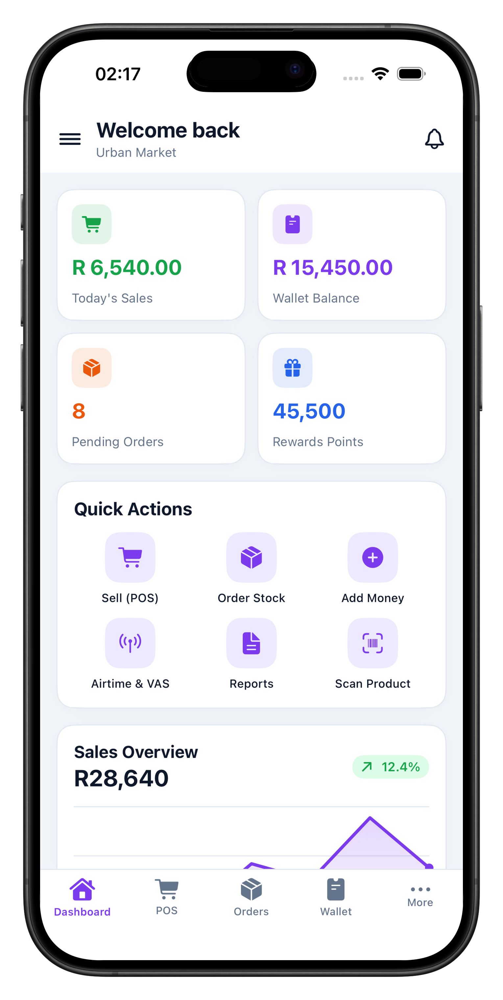
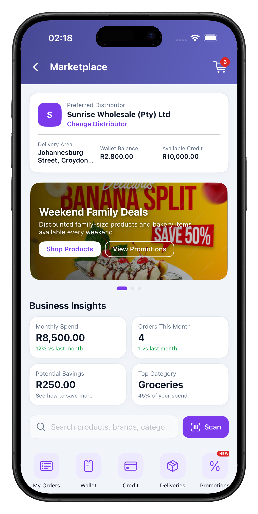
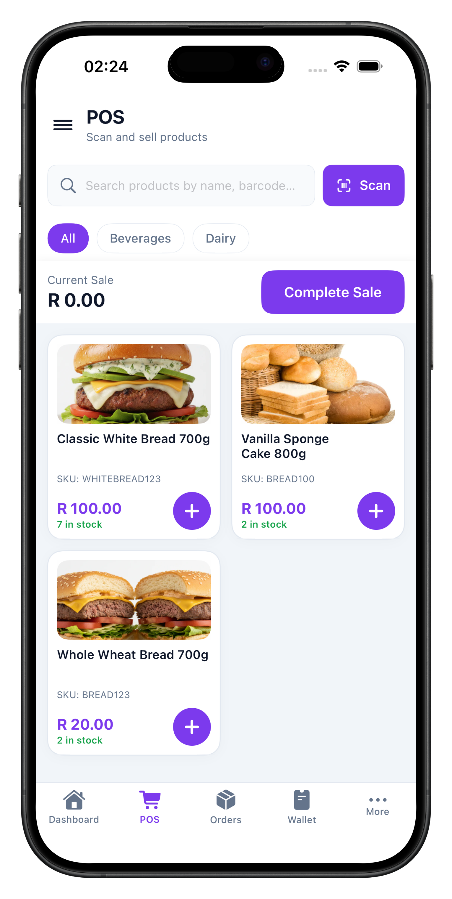
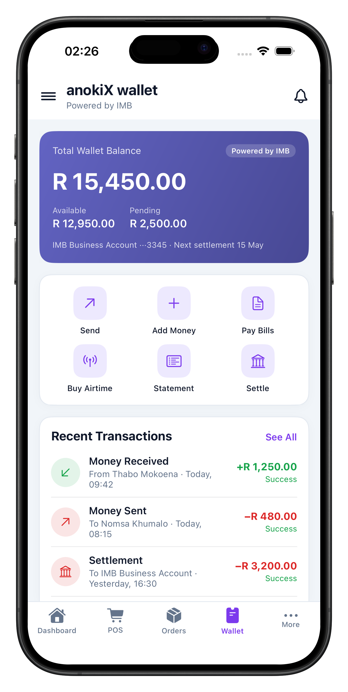

</div>

---

## About

anokiX connects **distributors** (wholesale suppliers) with **traders** (retail shops). This is the trader's app — built around a shop owner's day: restock from the marketplace, sell over the counter, and watch the cash.

It is a native **SwiftUI** port of the Android Trader app: same bundle id (`com.anokix.traderapp`), same backend, same modules and visual design system.

> [!NOTE]
> **The backend API is currently offline.** This repository is published as a reference for the app's **UI and user flows** — every screenshot below is a real capture from the running app, served by the bundled mock data. To run against live data, point it at your own backend and supply your own keys (see [Configuration](#configuration)).

---

## Screens and flows

### Sign in and get oriented

Welcome → login → a dashboard built for a shopkeeper: today's sales, wallet balance, pending orders and rewards points, then six quick actions (Sell, Order Stock, Add Money, Airtime, Reports, Scan), a weekly sales curve, top sellers and low-stock alerts. The drawer mirrors the trader portal's full module list.

<table>
<tr>
<td>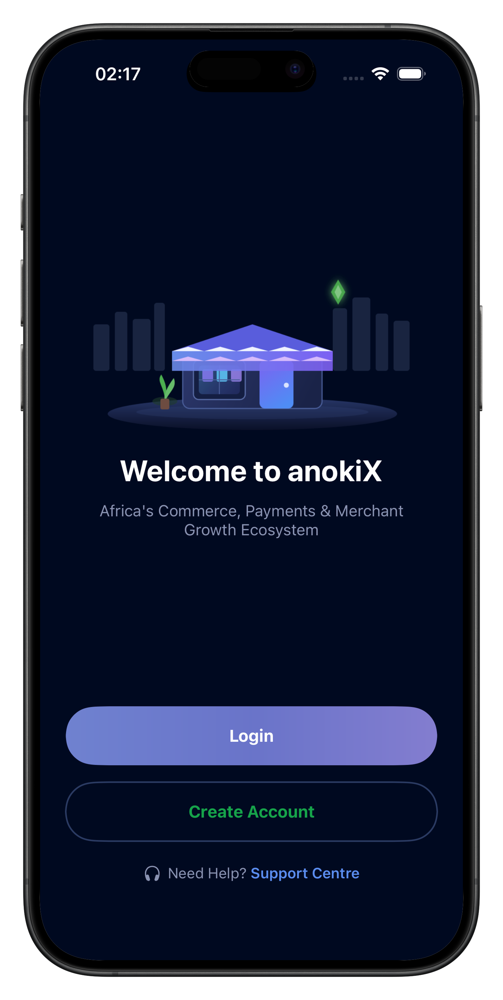</td>
<td>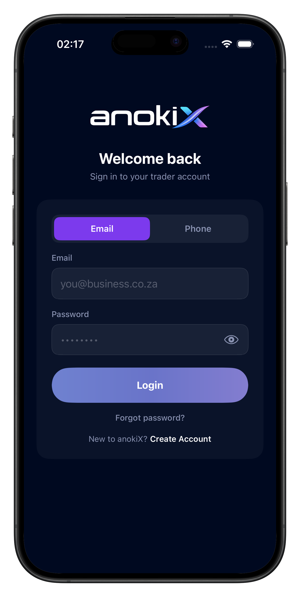</td>
<td></td>
<td>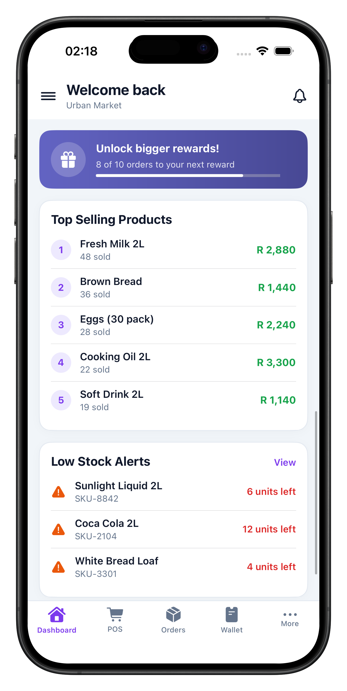</td>
<td>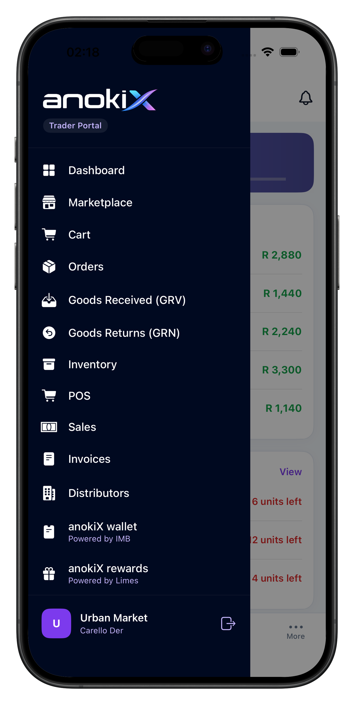</td>
</tr>
<tr>
<td align="center"><sub>Welcome</sub></td>
<td align="center"><sub>Login</sub></td>
<td align="center"><sub>Dashboard</sub></td>
<td align="center"><sub>Top sellers &amp; low stock</sub></td>
<td align="center"><sub>Drawer</sub></td>
</tr>
</table>

### Restocking flow — marketplace to credit note

The marketplace opens on the preferred distributor with wallet balance and available credit, then promo banners, spend insights, categories, recommendations and best sellers. Place the order and follow it through the same tracking timeline the distributor drives, with a purchase-order PDF at the end. Goods that arrive damaged go back through **Goods Returns (GRN)**, which issues a credit note.

<table>
<tr>
<td></td>
<td>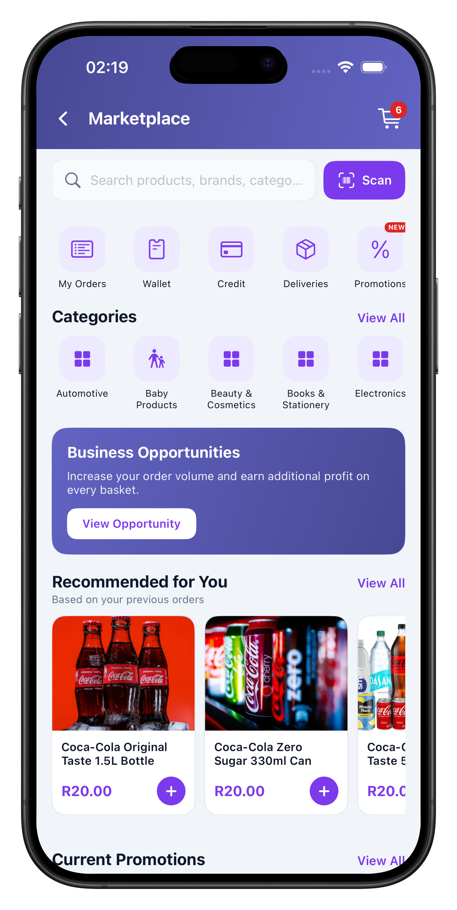</td>
<td>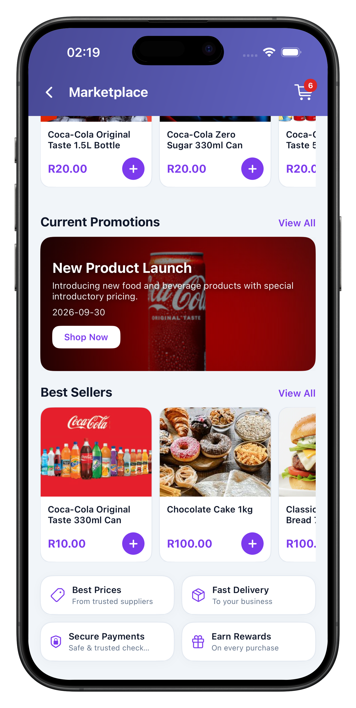</td>
<td>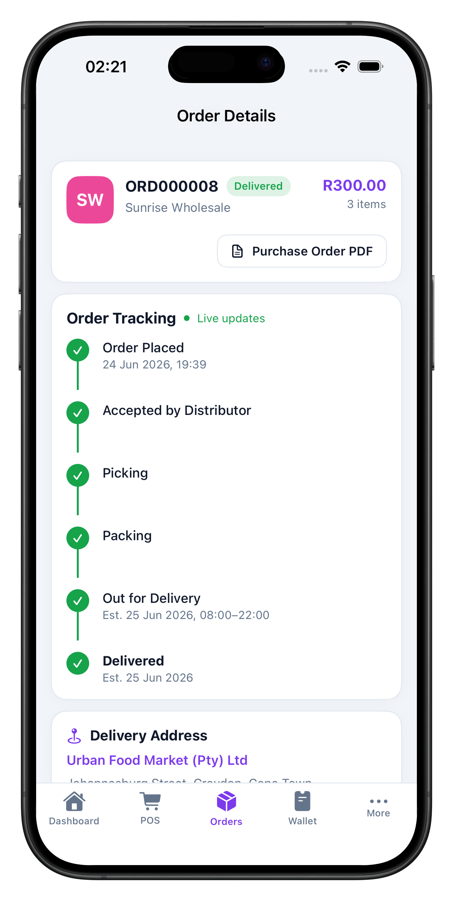</td>
<td>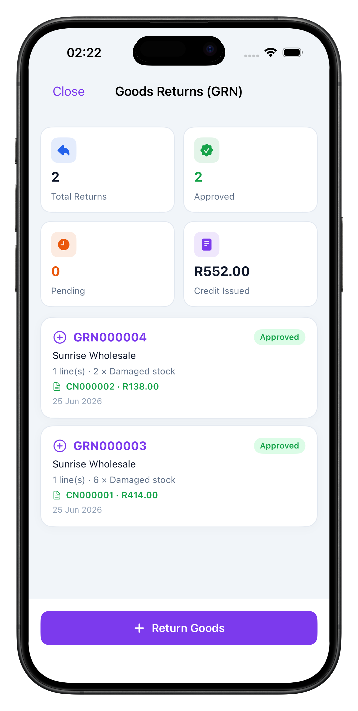</td>
</tr>
<tr>
<td align="center"><sub>Marketplace</sub></td>
<td align="center"><sub>Categories</sub></td>
<td align="center"><sub>Best sellers</sub></td>
<td align="center"><sub>Order tracking</sub></td>
<td align="center"><sub>Returns → credit note</sub></td>
</tr>
</table>

### Selling flow — the built-in POS

The POS is a till: search or scan, tap products into the current sale, then check out with discount, VAT and payment method. The same screen sells **airtime and VAS** — pick a bundle, choose whether it's for yourself or someone else, enter the recipient, and the commission is shown before you confirm.

<table>
<tr>
<td></td>
<td>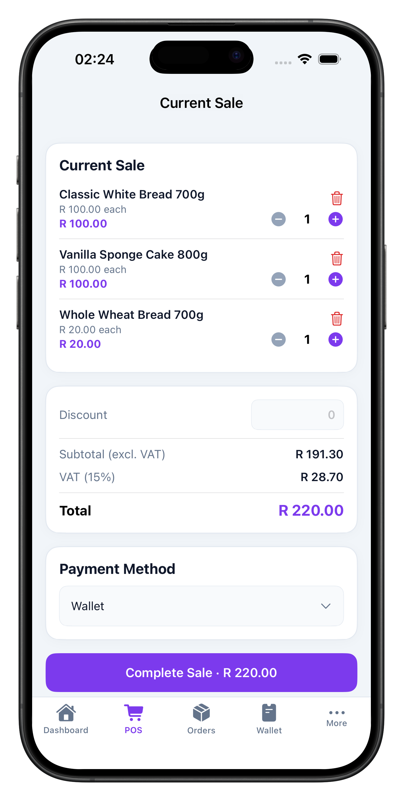</td>
<td>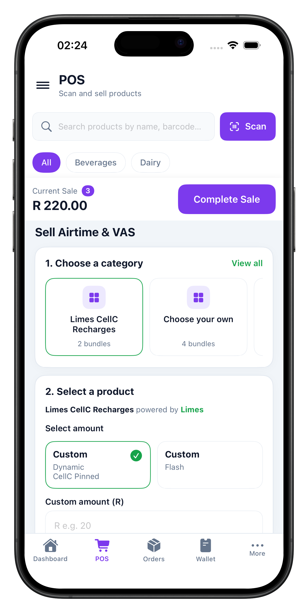</td>
<td>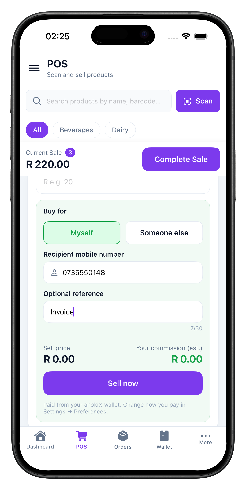</td>
<td>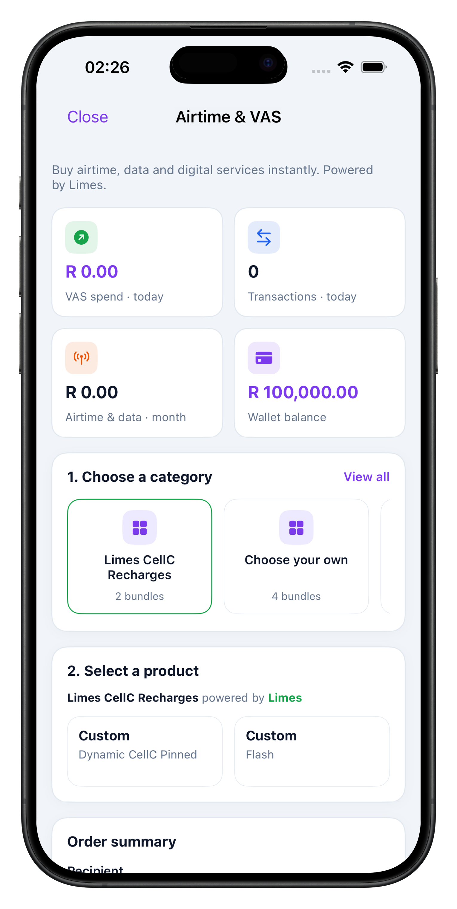</td>
</tr>
<tr>
<td align="center"><sub>POS grid</sub></td>
<td align="center"><sub>Checkout · VAT</sub></td>
<td align="center"><sub>Sell airtime</sub></td>
<td align="center"><sub>Recipient &amp; commission</sub></td>
<td align="center"><sub>Airtime &amp; VAS</sub></td>
</tr>
</table>

### Money, stock and insight

The wallet carries the balance, a settlement account and a send / add / pay-bills / buy-airtime action grid. Rewards tracks Limes points against a tier with quick-redeem vouchers. Inventory analytics reports gross profit, stock ageing buckets and reorder suggestions, while Analytics and Reports cover revenue, category mix and exportable summaries.

<table>
<tr>
<td></td>
<td>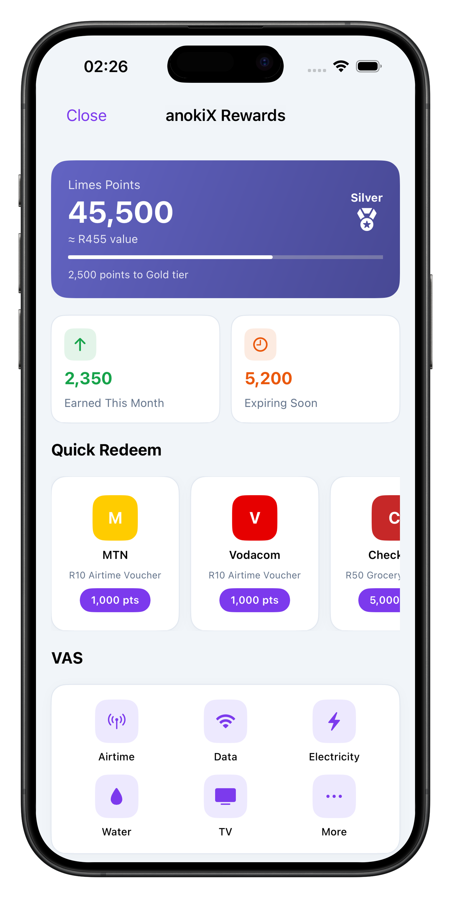</td>
<td>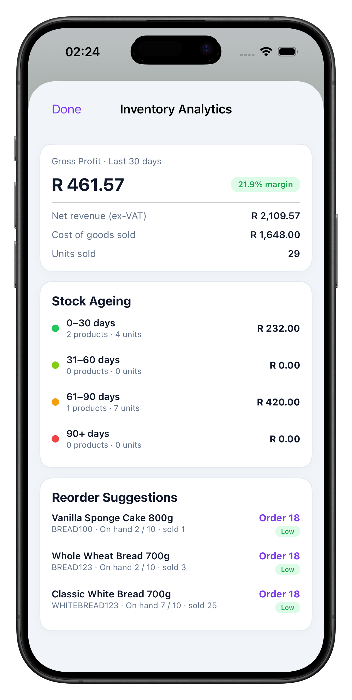</td>
<td>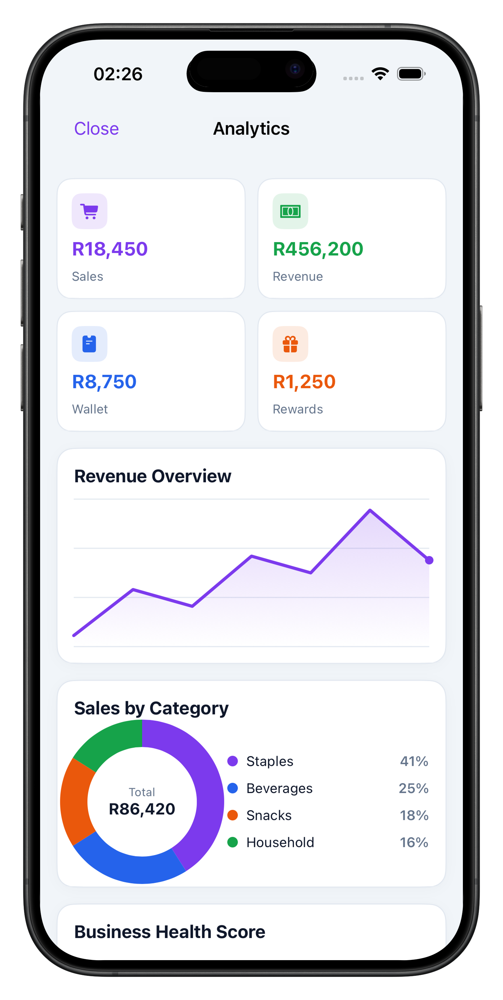</td>
<td>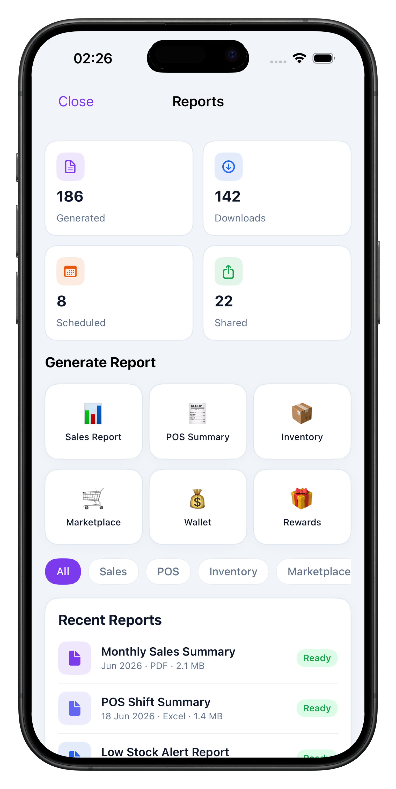</td>
</tr>
<tr>
<td align="center"><sub>Wallet</sub></td>
<td align="center"><sub>Rewards</sub></td>
<td align="center"><sub>Stock ageing &amp; reorder</sub></td>
<td align="center"><sub>Analytics</sub></td>
<td align="center"><sub>Reports</sub></td>
</tr>
</table>

<details>
<summary><b>All 27 screens</b></summary>

<br>

<table>
<tr>
<td></td>
<td></td>
<td></td>
<td>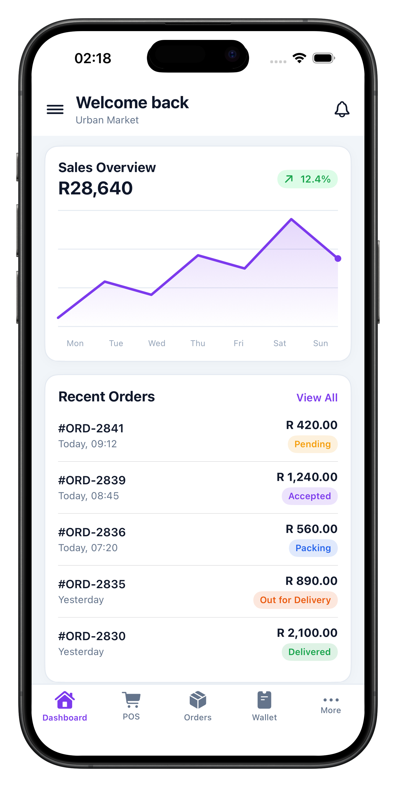</td>
<td></td>
<td></td>
</tr>
<tr>
<td align="center"><sub>Welcome</sub></td><td align="center"><sub>Login</sub></td><td align="center"><sub>Dashboard</sub></td><td align="center"><sub>Sales</sub></td><td align="center"><sub>Top sellers</sub></td><td align="center"><sub>Drawer</sub></td>
</tr>
<tr>
<td></td>
<td></td>
<td></td>
<td>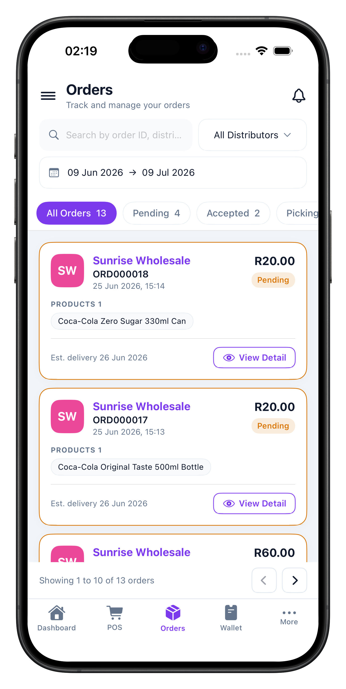</td>
<td></td>
<td></td>
</tr>
<tr>
<td align="center"><sub>Marketplace</sub></td><td align="center"><sub>Categories</sub></td><td align="center"><sub>Best sellers</sub></td><td align="center"><sub>Orders</sub></td><td align="center"><sub>Order detail</sub></td><td align="center"><sub>Returns</sub></td>
</tr>
<tr>
<td></td>
<td></td>
<td></td>
<td></td>
<td></td>
<td></td>
</tr>
<tr>
<td align="center"><sub>Stock analytics</sub></td><td align="center"><sub>POS</sub></td><td align="center"><sub>Checkout</sub></td><td align="center"><sub>POS airtime</sub></td><td align="center"><sub>Amount</sub></td><td align="center"><sub>Sell</sub></td>
</tr>
<tr>
<td></td>
<td></td>
<td>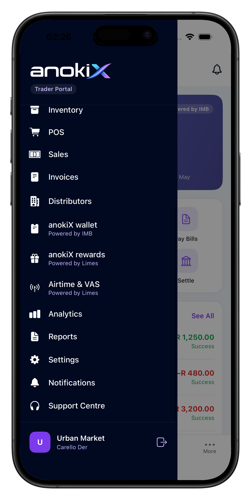</td>
<td></td>
<td></td>
<td></td>
</tr>
<tr>
<td align="center"><sub>Wallet</sub></td><td align="center"><sub>Rewards</sub></td><td align="center"><sub>Drawer (more)</sub></td><td align="center"><sub>Airtime &amp; VAS</sub></td><td align="center"><sub>Analytics</sub></td><td align="center"><sub>Reports</sub></td>
</tr>
<tr>
<td>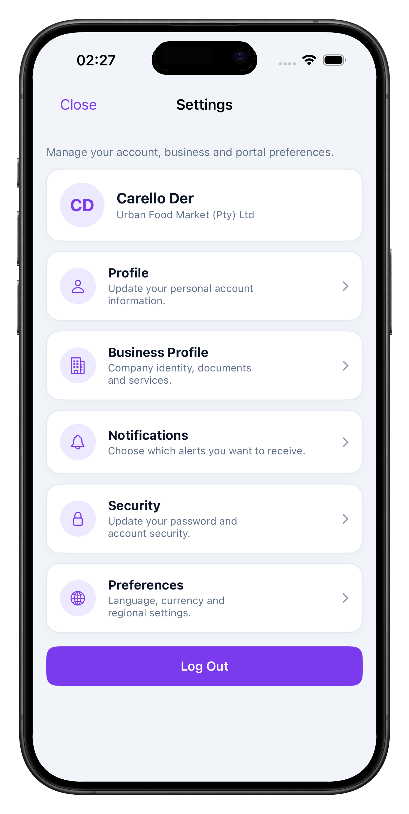</td>
<td>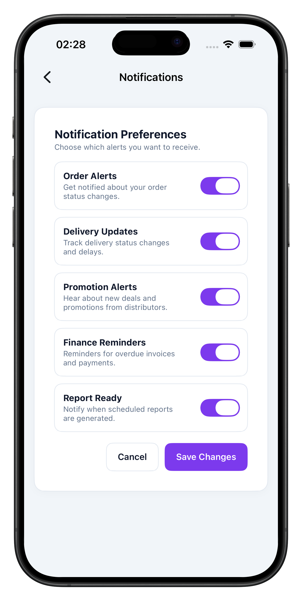</td>
<td>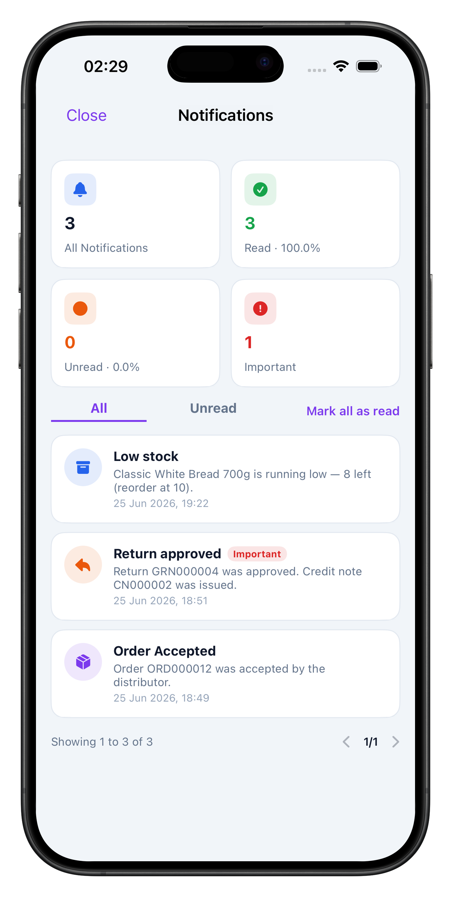</td>
<td></td><td></td><td></td>
</tr>
<tr>
<td align="center"><sub>Settings</sub></td><td align="center"><sub>Notification prefs</sub></td><td align="center"><sub>Notifications</sub></td><td></td><td></td><td></td>
</tr>
</table>

</details>

---

## Features

| Area | Capability |
| --- | --- |
| **Dashboard** | Sales KPIs, quick actions, weekly sales chart, top products, low-stock alerts |
| **Marketplace** | Browse distributors, categories, collections and promotions; cart and checkout with delivery slots |
| **Sell (POS)** | Scan or search, cart, discount, VAT, payment method, receipt |
| **Orders** | Order history with a tracking timeline and purchase-order PDF |
| **Goods Received / Returns** | Confirm deliveries against orders (GRV); raise and track returns (GRN) with credit notes |
| **Inventory** | Shop stock levels, filters, adjustments, stock history, gross profit, stock ageing, reorder suggestions |
| **Invoices &amp; Payments** | Invoice list and payment records |
| **Wallet** | Balance, settlement account, send / add money / pay bills, transactions |
| **Rewards** | Limes points balance, tier progress, quick-redeem vouchers, VAS shortcuts |
| **Airtime / VAS** | Service catalogue, customers, subscriptions and dynamic services |
| **Analytics &amp; Reports** | Revenue trends, category donut, business health score, exportable reports |
| **Customers &amp; Staff** | Customer book; staff accounts with their own till sign-in |
| **Settings &amp; Support** | Profile, business, security, preferences; ticketed support with WhatsApp hand-off |
| **Push** | Firebase Cloud Messaging, token registered on login and removed on logout |

---

## Tech stack

- **Swift**, **SwiftUI**, iOS 16.0+, universal (iPhone + iPad)
- Project generated by **XcodeGen** from `project.yml` — adding a source file needs no `.pbxproj` edit
- Dependencies via **CocoaPods**:

  | Pod | Purpose |
  | --- | --- |
  | **Alamofire** ~> 5.9 | HTTP transport (`Networking/APIClient.swift`) |
  | **SwiftyJSON** ~> 5.0 | `{ status, message, data }` envelope parsing |
  | **Kingfisher** ~> 7.0 | Remote image loading with memory and disk caching |
  | **GoogleMaps** ~> 9.0 | Location step in Create Account |
  | **Firebase/Messaging** ~> 11.0 | Push notifications |

  Domain models decode with `Codable`; SwiftyJSON only unwraps the envelope.

### Architecture

- **`Router`** (an `ObservableObject`) holds the selected tab, drawer state and the currently presented secondary module.
- **Five bottom tabs** — Dashboard, POS, Orders, Wallet, More — each a `NavigationStack`.
- **Secondary modules** (Inventory, Marketplace, Analytics, Reports, Rewards, Settings, …) open as `fullScreenCover`s hosted by `ModuleHost`, mirroring the Android Activities reached from the drawer.
- **One observable store per feature** (`MarketStore`, `PosStore`, `OrdersStore`, `WalletStore`, `VasStore`, …) sits between the views and `APIClient`.
- The left **drawer** mirrors the trader portal sidebar exactly, with a profile and logout footer.

---

## Getting started

### Prerequisites

- macOS with **Xcode 15** or newer
- `brew install xcodegen cocoapods`

### Generate and run

```bash
xcodegen generate            # creates AnokiXTrader.xcodeproj from project.yml
pod install                  # installs pods, creates the .xcworkspace
open AnokiXTrader.xcworkspace
```

Always open the **`.xcworkspace`**, never the `.xcodeproj`. Set a Development Team under *Signing &amp; Capabilities* the first time you run on a device. Re-run `xcodegen generate && pod install` after adding files or editing the `Podfile`.

<details>
<summary><b>Build error:</b> <code>Pods-AnokiXTrader-frameworks.sh: Permission denied</code></summary>

<br>

CocoaPods shell scripts lose their executable bit when the repo is checked out on Windows. The `Podfile`'s `post_install` hook restores it and routes embed scripts through `/bin/bash`, so a plain `pod install` usually fixes it. To repair manually:

```bash
find "Pods/Target Support Files" -name "*.sh" -exec chmod +x {} \;
```

</details>

### Configuration

No credentials are committed. Supply your own before the app can reach live data:

| What | Where |
| --- | --- |
| API base URL | `APIClient.baseURL` in `Networking/APIClient.swift` |
| Google Maps API key | `Networking/GoogleMapsConfig.swift` |
| Firebase / FCM | `GoogleService-Info.plist` |
| APNs auth key (`.p8`) | Upload to the Firebase console — **never commit it** |

Create your own Firebase project and Google Cloud API key, enable **Maps SDK for iOS**, and restrict the key to the `com.anokix.traderapp` bundle ID.

---

## Project structure

```
AnokiXTrader/
├── App/           App entry + RootView (splash → welcome → login → main)
├── Theme/         Brand palette, Color(hex:), cards, chips, badges, button styles
├── Models/        Structs ported 1:1 from the Android model package
├── Data/          AppState, LoginSessionStore, MockData
├── Components/    Charts, rows, form controls, image picker, country picker, remote media
├── Networking/    APIClient (typed endpoints, Alamofire), DTOs, PushManager, GoogleMapsConfig
└── Features/
    ├── Auth/          Login, register, pending approval
    ├── Main/          MainTabView, Router, drawer, More
    ├── Dashboard/     KPIs, quick actions, sales chart, recent orders
    ├── Sell/          POS grid, scanner, checkout
    ├── Marketplace/   Distributors, categories, collections, cart, promotions
    ├── Orders/        List + tracking-timeline detail
    ├── GoodsReceived/ GRV confirmation
    ├── GoodsReturns/  GRN + credit notes
    ├── Inventory/     Stock levels, adjustments, analytics
    ├── Invoices/      Invoice list
    ├── Wallet/        Balance, actions, transactions
    ├── Rewards/       Points, tiers, vouchers, VAS
    ├── Airtime/       Catalogue, customers, subscriptions, dynamic services
    ├── Analytics/     Revenue, category mix, health, insights
    ├── Reports/       Generation + recent reports
    ├── Staff/         Staff accounts and passwords
    ├── Settings/      Profile, business, security, preferences, notifications
    └── Support/       Contacts, knowledge base, tickets
```

- **Auth** is a bearer token from `api/common/login`, persisted in `UserDefaults` and attached to every later request. Registration can land in a *pending approval* state, rendered as its own screen.
- **`MockData.swift`** backs every screen when no API is reachable — which is how the captures above were produced.
- Every Swift file lives under `AnokiXTrader/` and is auto-included via the XcodeGen target glob.

---

## Related repositories

| App | Platform |
| --- | --- |
| anokiX Trader | iOS *(this repo)* · Android |
| anokiX Distributor | iOS · Android |

---

## Status

All screens are implemented; the app is at version 1.0.7. The project is authored on Windows and generated with XcodeGen, so a first build on a Mac may surface minor adjustments. The backend API is offline, so the app currently runs against its bundled mock data.

## License

Released under the [MIT License](LICENSE).
